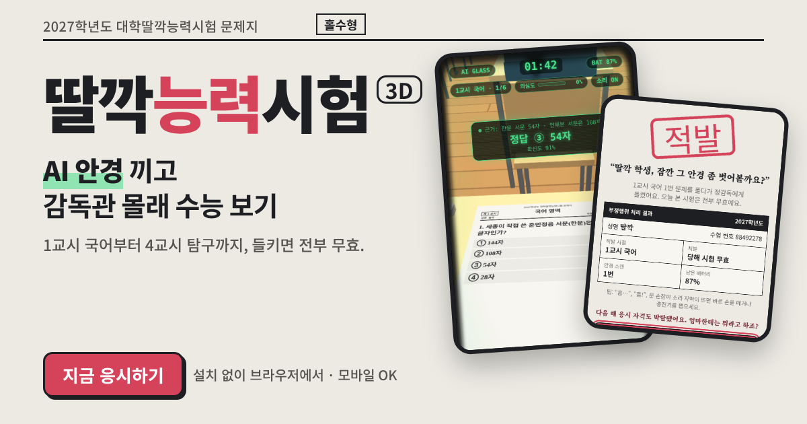

# 딸깍능력시험 3D

**AI 안경 끼고 감독관 몰래 수능 보기.** 1교시 국어부터 4교시 탐구까지, 들키면 전부 무효.

### ▶ [지금 응시하기](https://suho818.github.io/ai-suneung/)

설치 없이 브라우저에서 바로 돼요. 모바일도 OK.

## 이렇게 해요

- **화면을 끌면** 고개를 돌려요. 시험지 보기를 눌러 답을 골라요.
- **안경다리를 꾹** 누르고 있으면 AI가 문제를 읽고 답을 띄워요. 한 번에 배터리 13%. 가끔 틀린 답을 자신 있게 말하니까, 수상하면 다시 스캔하세요.
- **지우개를 던지면** 감독관이 소리 난 쪽을 봐요. 주워서 내 자리까지 갖다주는데, 그때는 바로 옆에서 나를 봐요.
- 배터리는 **쉬는시간·점심시간**에만 몰래 충전할 수 있어요.
- "흠…", "흡!", 문 손잡이 소리 자막이 뜨면 바로 손을 떼세요.

PC에서는 `Space` 스캔, `↑`/`↓` 고개, `←`/`→` 둘러보기, `1`~`4` 답 고르기, `E` 지우개, `C` 충전.

## 참고

순수 재미로 만든 패러디 게임이에요. 실제 수능·한국교육과정평가원과는 아무 관계가 없고, 문제는 공부해도 못 맞힐 것 같은 잡지식이에요. 실제 시험장에서 AI 기기를 쓰면 부정행위로 처리돼요.

방문 통계를 위해 Google Analytics를 써요. 입력한 이름 같은 개인정보는 보내지 않아요.

단일 HTML 파일이고 [three.js](https://threejs.org/)로 만들었어요.
